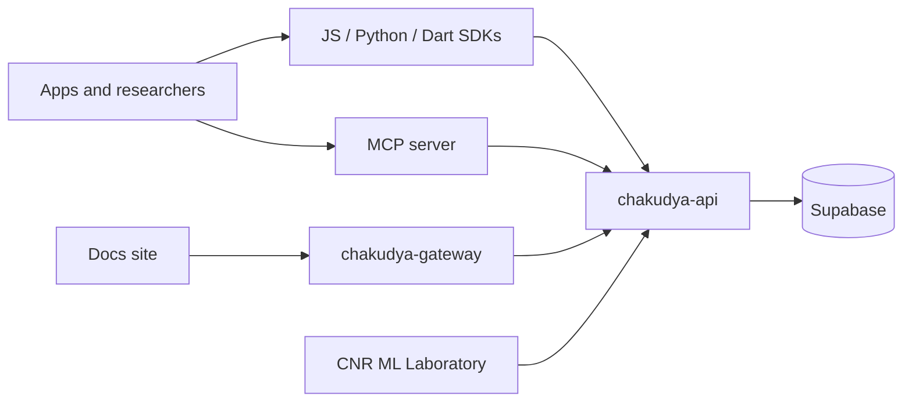

<h1 align="center">Hi, I'm Edison Taimu 👋</h1>

  Dietitian and self-taught developer building clinical nutrition software from Zomba, Malawi 🇲🇼

  
  
  

---

## 👋 About me

I hold a BSc in Nutrition and Dietetics (Pioneer Cohort) from the Kamuzu University of Health Sciences (KUHeS) in Blantyre, and I teach myself to code so I can build the tools I wish dietitians in Malawi had.

My work sits between **clinical nutrition** and **software**: open food and nutrient data, deterministic clinical calculators, and carefully scoped AI that supports (never replaces) a trained health worker.

I am looking for **global health innovation internships** and institutional support to take these projects further.

---

## 🌽 Main project: Chakudya Nutrition Registry (CNR)

CNR is an open, Malawi-focused nutrition platform for health apps, researchers, dietitians and developers. It is built as a Cloudflare Worker backed by Supabase and serves food composition data, clinical nutrition tools, WHO growth standards and a retrieval-augmented knowledge base through one JSON API.

| Part | What it is | Link |
|---|---|---|
| **chakudya-api** | The core API: foods, packaged foods, clinical tools, energy calculators, growth standards and RAG | [repo](https://github.com/edisontaimu9-ui/chakudya-api) · [chakudya.xyz](https://chakudya.xyz/#/) |
| **Chakudya-docs** | Documentation site for the API | [repo](https://github.com/edisontaimu9-ui/Chakudya-docs) |
| **chakudya-gateway** | Cloudflare Worker in front of the API for public docs traffic and an admin monitor | [repo](https://github.com/edisontaimu9-ui/chakudya-gateway) |
| **chakudya-mcp-server-cloudflare** | MCP server exposing calculators, reference tables, screening workflows and CNR lookups as tools | [repo](https://github.com/edisontaimu9-ui/chakudya-mcp-server-cloudflare) |
| **Chakudya-sdk** | Zero-dependency JavaScript client | [repo](https://github.com/edisontaimu9-ui/Chakudya-sdk) |
| **chakudya-python** | Python client (standard library only) | [repo](https://github.com/edisontaimu9-ui/chakudya-python) |
| **chakudya-dart** | Dart and Flutter client | [repo](https://github.com/edisontaimu9-ui/chakudya-dart) |
| **cnr-ml-laboratory** | Governed machine learning workspace for nutrition data: de-identification, exploration, model training and comparison, evaluation and versioning | [repo](https://github.com/edisontaimu9-ui/cnr-ml-laboratory) · [ml-lab.chakudya.xyz](https://ml-lab.chakudya.xyz) |

---

## 🩺 Clinical and screening tools

| Project | What it does | Status |
|---|---|---|
| [**thanzi-screening-engine**](https://github.com/edisontaimu9-ui/thanzi-screening-engine) | Stateless screening service for acute malnutrition in children under five, using WHO growth standards and Malawi CMAM guidelines, with advisory ML flags and an audit trace | Release candidate, not clinically validated. Decision support only |
| [**clinical-nutrition-ai**](https://github.com/edisontaimu9-ui/clinical-nutrition-ai) | Privacy-first drafting and checking assistant for dietitians (ADIME documentation, missing-data checks) | Early planning, synthetic data only |
| [**energy-engine-**](https://github.com/edisontaimu9-ui/energy-engine-) | Energy expenditure engine ([live](https://energy-expenditure-engine.onrender.com)) | Active |
| [**Metabolism-simulator-**](https://github.com/edisontaimu9-ui/Metabolism-simulator-) | Metabolism simulation in Python | In development |

---

## 📱 Apps and web tools

- **[Thanzi](https://github.com/edisontaimu9-ui/thanzi)**: a food and fitness tracker for Malawi ([live](https://edisontaimu9-ui.github.io/thanzi/))
- **[Thanzi Guide](https://github.com/edisontaimu9-ui/thanzi-guide-)**: Malawi-focused nutrition and food guide ([live](https://edisontaimu9-ui.github.io/thanzi-guide-/))
- **[Thanzi Coach (WhatsApp)](https://github.com/edisontaimu9-ui/thanzi-coach-whatsapp)**: nutrition coaching over WhatsApp
- **[DietitianOS](https://github.com/edisontaimu9-ui/dietitianos)**: tools for dietitians ([live](https://edisontaimu9-ui.github.io/dietitianos/))
- **[Oasis CNST](https://oasiscnst.app/)**: clinical nutrition app for health professionals
- **[admin-hub](https://github.com/edisontaimu9-ui/admin-hub)**: control panel ([live](https://hub.edisontaimu.online))
- **[Portfolio](https://github.com/edisontaimu9-ui/Portfolio-)**: [edisontaimu.online](http://edisontaimu.online/)

---

## 🔬 Research

- Undergraduate research on household food insecurity among KUHeS students (FIES, n = 291), presented as a poster at the Research Dissemination Conference.

---

## 🛠️ Tech stack

  
  
  
  
  
  

  
  
  
  

---

## 📊 GitHub stats

  
  

---

## 🎯 Currently working on

- Growing the **CNR ML Laboratory** (dashboard and corpora tooling)
- Packaging the **Thanzi screening engine** as a deployable service
- Early design of a clinician-facing **nutrition documentation assistant**
- Expanding the Chakudya API and its SDKs

---

## 📫 Connect

- GitHub: [@edisontaimu9-ui](https://github.com/edisontaimu9-ui)
- Portfolio: [edisontaimu.online](http://edisontaimu.online/)
